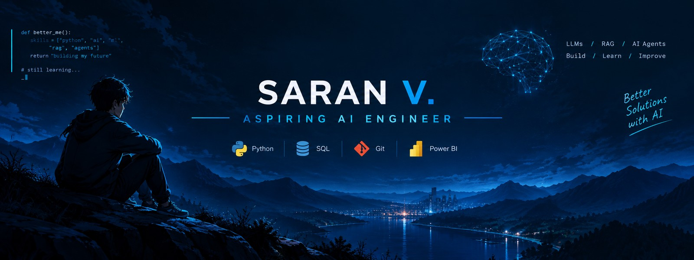

  

# Hi, I'm Saran!

### Final-Year Artificial Intelligence & Data Science Engineering Student

I'm an aspiring AI Engineer interested in building practical software solutions using Python and modern AI technologies.

I'm currently strengthening my programming fundamentals and exploring the technologies behind AI-powered applications.

### Currently Learning
- Python Programming
- Git and GitHub
- APIs and Backend Development
- Large Language Models (LLMs)
- Retrieval-Augmented Generation (RAG)
- AI Agents and Automation

### Technical Skills
- **Programming:** Python, SQL
- **Data Tools:** Excel, Power BI
- **Currently Exploring:** LLMs, RAG, AI APIs

### Projects

**[Python Learning Projects](https://github.com/saranv30/python-learning-projects)**

A collection of practical Python projects built to improve my programming and problem-solving skills.

### Connect With Me

- [LinkedIn](https://www.linkedin.com/in/saran-v-4aa983372/)
- [GitHub](https://github.com/saranv30)

---

*Learning, building, and improving one project at a time.*
